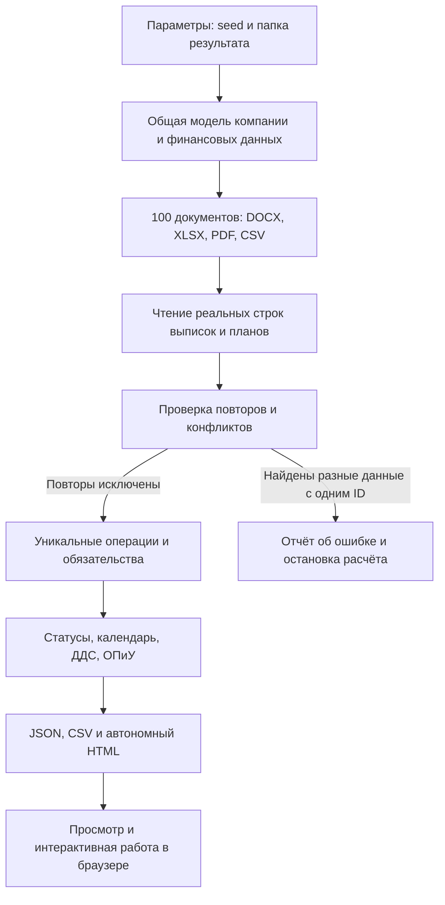
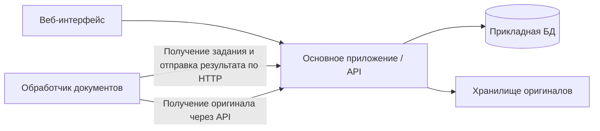

# Распределённая информационная система формирования платёжного календаря

Курсовая работа по дисциплине «Технологии конструирования систем обработки данных».

## Статус и цель

Согласована концепция, создан визуальный макет. Реализован интерактивный локальный прототип: генератор 100 синтетических документов для 20 контрагентов с проверкой повторов и браузерное приложение с главной страницей, разделами календаря, обязательств, ОПиУ и ДДС и регистрацией демонстрационных оплат (см. запуск ниже). Основной язык утверждён пользователем: **C#**. В `Solution1.sln` добавлены приложение `src/FinPlan` и тесты `tests/FinPlan.Tests`, используется установленный .NET 10. Генерация документов, проверка повторов, календарь, ОПиУ и ДДС перенесены на C#. Интерфейс остаётся HTML/CSS/JavaScript. Серверная часть с постоянным хранением и обработкой пользовательских загрузок ещё не реализована; распределённая архитектура и число сервисов пока не утверждены. Ниже исходные требования отделены от предложений, которые необходимо обсудить.

Цель — создать веб-приложение, объединяющее разнородные финансовые данные, формирующее платёжный календарь, прогнозирующее остатки и выявляющее кассовые разрывы. Система помогает принимать решения; автоматическое проведение банковских платежей в объём не входит.

## Что уже реализовано и как это работает

На текущем этапе создан рабочий локальный прототип «ФинПлан» с C#-сервером для просмотра и перегенерации тестовых наборов. Его можно запустить из Rider как C#-проект, получить набор финансовых документов и открыть приложение в браузере. Прототип проверяет модель данных и финансовые расчёты до разработки полноценного сервера.

### Разделение работы между C# и браузером

**C# / .NET 10** создаёт синтетические данные и документы, читает таблицы выписок и планов, исключает повторы, рассчитывает исходный календарь и отчёты, сохраняет результаты на диск. При обычном запуске приложение поднимает локальный ASP.NET Core-сервер на `127.0.0.1` со свободным портом, открывает интерфейс и работает до остановки. Сервер нужен для кнопки перегенерации. Режимы `--generate` и `--check` остаются одноразовыми командами.

**HTML и CSS** задают страницы, таблицы, карточки и оформление. **JavaScript** переключает разделы, обрабатывает фильтры, рисует график и пересчитывает данные при регистрации оплат или изменении даты. Файл `calendar_view.html` содержит встроенные данные и код, поэтому для просмотра не нужен отдельный сервер, Node.js или подключение к интернету. Для перехода к исходным документам рядом должна оставаться папка `documents`. Открытие HTML как файла поддерживает просмотр и регистрацию оплат в памяти, но кнопка перегенерации работает только при запуске через локальный C#-сервер.

Финансовая логика существует в двух реализациях: на C# для подготовки исходного набора и на JavaScript для интерактивной работы автономного HTML. Это временное решение для текущего этапа. Совпадение начальных результатов проверяется тестами по всем датам, валютам и отчётам. Локальный сервер пока управляет только тестовыми наборами и выдаёт файлы; постоянное хранение пользовательских оплат и единый серверный расчётный API предстоит разработать.

### Структура проекта и назначение файлов

```text
Solution1.sln
├── src/FinPlan/                     # Основное C#-приложение
│   ├── Program.cs                   # Режимы CLI и запуск локального сервера
│   ├── DemoHost.cs                  # HTTP-интерфейс перегенерации и выдача файлов
│   ├── DemoStore.cs                 # Снимки наборов и переключение текущего
│   ├── Models.cs                    # Модели данных и сериализация JSON
│   ├── DemoGenerator.cs             # Создание связанного набора и сборка HTML
│   ├── DocumentFiles.cs             # Запись документов, чтение CSV/XLSX
│   ├── OpenXmlTemplates.cs           # Служебные части DOCX/XLSX
│   ├── DuplicateChecker.cs          # Проверка файлов и повторных строк
│   ├── FinanceCalculator.cs         # Статусы, календарь, ДДС и ОПиУ
│   ├── Assets/                      # Шрифт для PDF и его лицензия
│   ├── Properties/launchSettings.json
│   └── packages.lock.json           # Зафиксированные NuGet-зависимости
├── demo/
│   ├── viewer.html                  # Исходный шаблон интерфейса
│   ├── finance.js                   # Точный расчёт в браузере
│   └── run.sh                       # Дополнительный запуск через dotnet
├── tests/
│   ├── FinPlan.Tests/               # C#-тесты расчётов и документов
│   ├── test_finance.cjs             # Проверки браузерной финансовой логики
│   └── test_viewer.cjs              # Проверки навигации и обработчиков форм
├── output/                          # Сгенерированные документы и результаты
├── .run/FinPlan.run.xml              # Общая конфигурация запуска Rider
├── global.json                      # Выбор SDK .NET 10
├── README.md                        # Описание и требования
└── AGENTS.md                        # Правила работы над проектом
```

| Компонент | Что делает |
| --- | --- |
| `Program.cs` | Находит корень решения и выбирает одноразовую генерацию, проверку либо локальный веб-запуск |
| `DemoHost` | Выдаёт страницы и документы, принимает запрос перегенерации; слушает только локальный адрес |
| `DemoStore` | Создаёт набор в новой папке, публикует его после успеха, сохраняет текущий ID и блокирует параллельные генерации |
| `DemoGenerator.Build` | Формирует общую модель: компанию, счета, контрагентов, обязательства, банковские операции и начисления |
| `DemoGenerator.Generate` | Создаёт файлы, запускает чтение таблиц и проверку повторов, рассчитывает данные, сохраняет JSON/CSV и HTML |
| `DemoGenerator.RenderViewer` | Подставляет JSON и JavaScript в шаблон интерфейса; получается автономный HTML |
| `DocumentFiles` | Записывает DOCX/XLSX как ZIP-пакеты OOXML, CSV — как текстовую таблицу, PDF — через SkiaSharp; читает фиксированную схему CSV/XLSX |
| `DuplicateChecker.Analyze` | Вычисляет SHA-256, сопоставляет строки по идентификаторам, сохраняет происхождение повторов и блокирует конфликтующие записи |
| `FinanceCalculator.Calculate` | Определяет факт на дату среза, непогашенные суммы, статусы и последовательность дневных остатков |
| `FinanceCalculator.BuildReports` | Отдельно строит кассовый ДДС и ОПиУ по начислениям |
| `Models.cs` | Описывает сущности и формат обмена; даты представлены `DateOnly`, деньги — `decimal`, в JSON суммы передаются строками |
| `demo/finance.js` | Пересчитывает календарь, статусы и отчёты в браузере; проверяет суммы и даты ручных оплат |
| `demo/viewer.html` | Отображает данные, маршруты разделов, фильтры, график, карточки и формы |

Исходный интерфейс нужно редактировать в `demo/viewer.html`, расчётную логику браузера — в `demo/finance.js`. `output/calendar_view.html` — результат сборки: следующий обычный запуск C#-приложения заново создаст его из шаблона и сохранённого JSON.

### Как проходит генерация



1. Генератор получает `seed`, по умолчанию 42. Даты периода и демонстрационные курсы фиксированы, псевдослучайные суммы воспроизводимы.
2. Создаётся одна вымышленная компания, 20 контрагентов и по одному счёту в RUB, CHF и GBP. Документальные обязательства и планы имеют стабильные идентификаторы.
3. Из общей модели создаются договоры, счета, акты, выписки и плановые реестры. Реквизиты между ними согласованы заранее. Для проверки добавляются точные копии, альтернативные представления договоров и повторные строки.
4. Выписки и планы читаются обратно из созданных CSV/XLSX. Таким образом, расчёт использует строки реальных файлов после исключения повторов. Связи договоров, счетов и актов и регистр начислений пока берутся из модели генератора — из DOCX/PDF они автоматически не извлекаются.
5. Проверяются дубликаты и конфликты. Однозначный повтор исключается из финансового расчёта, а сведения о его источнике сохраняются. Конфликт останавливает обработку.
6. По уникальным операциям рассчитываются оплата обязательств, начальные средства прогноза, дневной календарь и отчёты. Сохраняются `dataset.json`, `duplicates.json`, `reports.json` и `calendar.csv`.
7. В шаблон HTML встраиваются исходный набор и код интерфейса. При открытии браузер пересчитывает начальное состояние и отображает страницы.

В результате на диске находятся 100 исходных документов; после исключения повторов — 240 банковских операций и 420 обязательств/планов, из которых 20 сформированы по документам и 400 являются плановыми операциями. В каждой выписке и плановом реестре 20 уникальных строк операций и один намеренный повтор. Подробный состав файлов и ожидаемые количества повторов приведены далее.

При обычном повторном запуске существующие CSV/XLSX не импортируются заново: приложение выбирает последний успешный набор через `current.json` (или исходный `output/dataset.json`, если перегенераций ещё не было) и собирает его HTML из шаблона. Режим `--check` отдельно читает источники, проверяет повторы и выполняет расчёт, но не сохраняет обновлённые `dataset.json`, `reports.json`, `calendar.csv` или HTML. Поэтому редактирование исходного файла на диске пока не является полноценным пользовательским импортом.

### Как показать уже готовую часть

1. Запустить конфигурацию «ФинПлан — открыть календарь» в Rider.
2. На главной выбрать общую оценку или одну валюту, посмотреть показатели и график кассового разрыва.
3. Открыть «Проверка повторов», показать исключённые файлы и строки и ссылки на оригиналы.
4. Перейти в реестр, выбрать просроченное обязательство, открыть счёт, договор, акт и выписку.
5. Зарегистрировать часть либо весь непогашенный остаток и показать изменение статуса, даты среза, доступных денег и прогноза.
6. Открыть ДДС и показать новую фактическую операцию; открыть ОПиУ и объяснить, почему оплата не меняет уже признанную прибыль.
7. Вернуться к карточке и отменить ручную регистрацию, чтобы показать обратный пересчёт.

### Какие данные хранятся и как они связаны

| Сущность | Назначение и ключевые сведения |
| --- | --- |
| `Counterparty` | Идентификатор, вымышленное наименование и учебный регистрационный код контрагента |
| `Account` | Счёт, его валюта и начальный остаток на опорную дату |
| `Document` | Путь к оригиналу, тип, связанные обязательства, контрольная сумма и число строк реестра |
| `Obligation` | Основание, контрагент, направление, валюта, сумма, договорный срок, планируемая дата, оплаты и источники |
| `Operation` | Фактическая дата, счёт, валюта, направление, сумма, статья ДДС, ссылка на обязательство и строку выписки |
| `Accrual` | Начисление дохода или расхода: сумма, валюта, статья ОПиУ, дата признания и акт-основание |
| `CalendarDay` | Поступления, выплаты, начальный и конечный остатки дня по валютам и сводная оценка в RUB |
| `DuplicateReport` | Обнаруженные повторы и конфликты со ссылками на текущий и первоначальный источники |

Одна связка договор–счёт–акт описывает одно денежное обязательство. Несколько оплат могут погашать это обязательство частями. В текущей упрощённой модели операция содержит ссылку максимум на одно обязательство; полноценные распределения одной банковской операции между несколькими обязательствами ещё не реализованы. Это отличие от целевой модели «многие ко многим» учитывается при дальнейшей разработке.

### Что происходит после регистрации оплаты

В реестре пользователь открывает обязательство и вводит сумму и дату фактической операции. Браузер проверяет, что сумма положительная, не превышает остаток и имеет не более двух десятичных знаков. Затем создаётся новая демонстрационная банковская операция с уникальным ID и ссылкой на обязательство.

Пересчёт проходит последовательно:

1. На выбранную дату собираются фактические операции.
2. По каждому обязательству суммируются его оплаты.
3. Рассчитываются непогашенный остаток и статус.
4. Пересчитываются доступные средства и календарь; уже оплаченная часть не включается в будущие выплаты/поступления повторно.
5. ДДС включает новый факт движения денег. ОПиУ сохраняет доходы и расходы, признанные по актам.
6. Интерфейс обновляет показатели, график, реестр, карточку и отчёты.

При отмене ручной регистрации удаляется соответствующая операция текущей сессии и выполняется тот же пересчёт. Это не отмена реального банковского платежа. Подробные правила временного среза, автоматического изменения даты и хранения изменений описаны в разделе об интерактивных оплатах ниже.

### Как проверили реализацию

После расширения генератора и добавления кнопки прошли **26 автоматических тестов: 15 C# и 11 JavaScript**. Они проверяют не только наличие файлов, но и финансовые результаты:

- независимый малый пример частичной оплаты, дневных остатков и валютной оценки;
- широкий диапазон сумм и дат, разнообразие частичных оплат и неотрицательные фактические остатки;
- HTTP-путь перегенерации, сохранение предыдущего набора, восстановление текущего после перезапуска, отклонение параллельного запроса и откат при ошибке;
- состояние кнопки во время генерации, переход к готовому набору и сохранение страницы при ошибке;
- приоритет полной оплаты над просрочкой, отклонение переплаты и границы даты среза;
- различие кассового потока и прибыли, отдельный учёт займов и оборудования;
- наличие 100 документов, 20 контрагентов и минимум 20 уникальных операций в каждом реестре;
- структуру OOXML и наличие встроенного шрифта и Unicode-карты в PDF;
- обнаружение повторов, блокировку конфликта сумм и сохранение корректных отдельных операций с разными ID;
- совпадение календаря и отчётов до добавления повторов и после их исключения;
- совпадение C#-расчёта с браузерным расчётом для всех дат и валют;
- регистрацию, отмену и получение оплаты, изменение просрочки при смене даты;
- навигацию, фильтры, формы, валютные линии графика и его работу в последний день периода.

C#-тесты при запуске создают собственный временный набор документов. JavaScript-тесты используют сохранённый `output/dataset.json`. Проверки интерфейса выполняются на упрощённой модели DOM: они подтверждают работу логики, но не являются полной визуальной проверкой браузеров. Команды запуска тестов приведены ниже.

### Границы готовности и следующий этап

| Часть системы | Текущее состояние |
| --- | --- |
| Генерация документов, расчёты и запуск из Rider | Реализованы на C# |
| Чтение фиксированных выписок/планов CSV/XLSX, проверка повторов | Реализованы для демонстрационной схемы |
| Главная, календарь, обязательства, документы, контрагенты, ОПиУ и ДДС | Реализованы в автономном браузерном интерфейсе |
| Ручная регистрация и отмена оплаты, фильтры и валютный график | Работают в текущей сессии браузера |
| Извлечение условий и реквизитов из пользовательских DOCX/PDF | Пока не реализовано |
| Загрузка произвольных документов и подтверждение неоднозначных связей | Пока не реализованы |
| База данных, постоянное хранение оплат и аудит изменений | Пока не реализованы |
| Локальный ASP.NET Core HTTP-интерфейс перегенерации и выдача файлов | Реализован для тестовых наборов |
| Полноценный бизнес-API, отдельный обработчик документов и распределённые протоколы | Пока не реализованы |
| Утверждённый план, план/факт, сценарии, недельные итоги и остальные отчёты | Предстоит реализовать |
| Экспорт пользовательских отчётов PDF/Excel | Предстоит реализовать; создание исходных PDF/XLSX генератором не является экспортом отчётов |

Следующий предлагаемый шаг — перенести работу с обязательствами и оплатами в серверное приложение ASP.NET Core с постоянным хранением и API. После этого подключать загрузку файлов, отдельный обработчик документов, ручную проверку и историю изменений. Конкретная БД и границы процессов согласуются отдельно. На текущем этапе приложение ещё не является распределённой информационной системой; её обоснование и предлагаемая структура описаны в разделе архитектуры.


## Согласованный объём

Первая версия обслуживает одну компанию, несколько банковских счетов и три валюты: российские рубли (RUB), швейцарские франки (CHF) и фунты стерлингов (GBP). Мультивалютность добавлена по согласованию с пользователем. Документы обрабатываются по фиксированным шаблонам. Реальные банковские интеграции, OCR сканов и машинное обучение не нужны.

| Источник | Формат | Смысл данных |
| --- | --- | --- |
| Банковская выписка | CSV, XLSX | Фактические поступления и списания |
| Договор | DOCX, текстовый PDF | Условия, основания и сроки оплаты |
| Счёт, акт | XLSX, текстовый PDF | Конкретные обязательства и подтверждение исполнения |
| Плановая операция | Ручной ввод, Excel | Ожидаемые поступления и расходы |

Разнородность должна проявляться в разных правилах извлечения и интерпретации данных, а не только в поддержке расширений файлов.

Основные функции:

1. Загрузка, проверка и нормализация данных.
2. Извлечение контрагентов, сумм, дат и условий оплаты.
3. Связывание договоров, счетов, актов и банковских операций.
4. Учёт обязательств, частичных оплат и просрочек.
5. Платёжный календарь по дням и неделям с раскрытием до обязательств.
6. Прогноз остатков и выявление кассовых разрывов.
7. Сценарии задержки поступления, частичной оплаты, дополнительного расхода и переноса платежа.
8. Ручная проверка извлечённых данных, просмотр источников и история изменений.
9. Отчёты: движение денег (ДДС), прибыли и убытки (ОПиУ), план и факт, кассовые разрывы, задолженность, структура поступлений и выплат. ОПиУ добавлен по согласованию с пользователем; для него нужны отдельные данные начислений.
10. Экспорт отчётов в PDF и Excel. Сравнение плана с фактом использует сохранённую утверждённую версию плана.

## Интерфейс и визуальный ориентир

Приложенное изображение — ориентир оформления и структуры экранов. Его цифры, даты, название «ФинПлан», название компании и имя пользователя не являются требованиями или эталоном расчётов. Временный путь вложения не является ресурсом проекта; само изображение в репозиторий пока не добавлено.

Текущий стиль по пожеланию пользователя — «клубничная матча»: тёплый кремовый фон, тёмно-зелёная боковая навигация, молочные карточки, светло-зелёные выделения и клубничные акценты. Это уточнение палитры заменяет исходную графитово-розовую схему макета; структура экранов сохраняется. Поступления и выплаты различаются цветом и текстом; дефицит сопровождается числовым значением и подписью.

- **Обзор:** доступные средства на выбранную дату, ожидаемые поступления, планируемые выплаты, минимальный прогнозный остаток с датой; график остатка с нулевой линией и зоной дефицита; ближайшие платежи и переход к кассовому разрыву.
- **Календарь:** выбор периода, дневная детализация и недельные итоги, группировка по статьям, раскрытие обязательств, остатки на начало и конец дня, фильтры. Боковая карточка показывает сумму, контрагента, срок, статус, основания и ссылки на документы; доступны редактирование и перенос платежа.
- **Документы:** загрузка, состояние обработки, ошибки, проверка полей и связывание источников.
- **Отчёты:** период, таблицы и графики, ДДС, ОПиУ, план и факт, задолженность, структура потоков, экспорт.
- **Сценарии:** сравнение с базовым прогнозом, список изменений и влияние на дефицит.

Переключатель компании, уведомления и полноценное управление пользователями из макета не включаются автоматически в первую версию. Проценты изменения показателей выводятся только после определения базы сравнения.

## Предлагаемые правила предметной области — требуют согласования

### Факт, обязательства и источники

Договор задаёт условия и сам по себе не всегда создаёт денежное обязательство. Счёт и акт могут относиться к одному обязательству: импорт каждого документа не должен создавать повторный платёж. Неоднозначные связи подтверждает пользователь. Автоматический поиск кандидатов использует идентификатор контрагента, номер документа, сумму и даты; совпадение названия само по себе недостаточно.

Банковская операция — факт движения денег. Обязательство — ожидаемое поступление или выплата. Распределение оплаты связывает их как «многие ко многим»: одна операция может погасить несколько обязательств, одно обязательство может оплачиваться несколькими операциями. Сумма распределений не превышает доступную сумму операции и непогашенную сумму обязательства. Нераспределённый остаток виден отдельно.

Остаток обязательства = исходная сумма − подтверждённые распределённые оплаты. Частичная оплата уменьшает прогноз на остаток, исключая повторный учёт уже оплаченной части. Просрочка определяется по непогашенной сумме и договорному сроку на выбранную дату; ожидаемая дата платежа хранится отдельно. Отменённые обязательства исключаются из прогноза с сохранением истории.

Внутренний перевод между счетами меняет остатки отдельных счетов, но не общий денежный поток компании. Комиссия учитывается отдельным расходом. Дубликаты импорта проверяются по источнику, идентификатору операции и нормализованным реквизитам; одинаковые суммы и даты могут принадлежать разным операциям, поэтому спорные случаи требуют проверки.

### Время и деньги

Предлагается хранить деньги точным десятичным типом, а даты обязательств — календарными датами. Начальные остатки задаются для каждого счёта на начало опорной даты. Только фактические операции от этой даты изменяют остаток; более ранние операции уже включены в начальное значение.

Для первой версии предлагается прогноз с начала выбранного дня: предыдущие дни учитываются по факту, с выбранного дня — по непогашенным обязательствам и плановым операциям. Оплата уменьшает обязательство только при попадании в фактический срез. Дата среза и момент актуальности данных отображаются пользователю. Исторический прогноз «как было известно тогда» потребует отдельного механизма версий и пока не обещается.

Остаток на конец дня = остаток на начало дня + поступления дня − выплаты дня. Следующий день начинается с предыдущего конечного остатка. Недельные потоки суммируются; остатки берутся на границах недели, а не складываются. Внутридневной порядок платежей не моделируется.

Кассовый разрыв — отрицательный конечный остаток дня; минимальный резерв предлагается сначала принять равным нулю. Отчёт показывает интервал отрицательных остатков и максимальную нехватку внутри интервала. Для просроченных обязательств без новой ожидаемой даты предлагается перенос в первый день прогноза с явной пометкой, чтобы долг не исчезал из расчёта.

На первом этапе сроки вычисляются в календарных днях по поддержанным шаблонам условий. Правила рабочих дней, праздников и переноса выходных требуют отдельного согласования. Несопоставимые или неподдержанные условия отправляются на ручную проверку.

### План, сценарии и отчёты

Текущий прогноз изменяется при новых данных. Утверждённый план — неизменяемый снимок сумм, дат, статей, счетов и связей с обязательствами на момент утверждения. Исправление создаёт новую версию; сравнение с фактом явно указывает выбранную версию. Факт группируется по дате банковской операции, план — по дате в снимке.

Сценарий хранит изменения относительно зафиксированной базы: перенос даты, изменение ожидаемой доли оплаты, дополнительный расход. Частичная оплата в сценарии означает предположение о будущем поступлении/выплате и не создаёт банковский факт. Необходимо явно задать судьбу оставшейся части: другую дату либо неопределённый срок с предупреждением. Сценарий не изменяет базовые обязательства. Сравниваются минимум остатка, первый день дефицита, максимальная нехватка и остаток на конец периода.

В отчёте «план и факт» предлагается отклонение = факт − план; благоприятность зависит от типа потока. Для нулевого плана процент отклонения не вычисляется. Отчёт по задолженности использует непогашенные обязательства, по движению денег — банковский факт. Экспорт использует те же фильтры и расчёты, что экран, и содержит период, дату формирования и версию плана/сценария, если применимо.

## Предлагаемая архитектура

Для курсовой рекомендуется начать с двух независимо запускаемых серверных приложений и веб-интерфейса. Это предложение, а не утверждённое ограничение.



**Основное приложение:** загрузка и очередь заданий, ручная проверка, справочники, связи, обязательства, распределения оплат, календарь, сценарии, версии плана, отчёты и экспорт. Внутри — модули с явными границами; календарь и обязательства пока не требуют отдельных процессов.

**Обработчик документов:** чтение CSV/XLSX/DOCX/текстового PDF, проверка шаблона, извлечение и нормализация, возврат кандидатов полей с указанием листа/строки, страницы или абзаца. Он не создаёт подтверждённые обязательства самостоятельно.

**Распределённость обоснована** отдельным жизненным циклом обработки: чтение документов выполняется вне HTTP-запроса пользователя, может занимать время и завершаться ошибками. Сбой или остановка обработчика не блокирует просмотр календаря. Компоненты взаимодействуют по сети и могут запускаться на разных узлах. Браузер сам по себе не служит обоснованием распределённой серверной архитектуры.

Для первой версии предлагается очередь заданий в БД основного приложения, доступная обработчику через внутренний API: получение с ограниченной по времени арендой, подтверждение результата, повтор после истечения аренды. Идентификатор задания, версия шаблона и идемпотентное принятие результата защищают от повторного выполнения. Это доставка с возможными повторами, а не гарантия однократного исполнения. Прямой доступ обработчика к прикладным таблицам не требуется.

Состояния задания: «загружен», «в очереди», «обрабатывается», «требует проверки», «подтверждён», «ошибка». Статус извлечения и факт применения данных должны различаться; изменение подтверждённых полей оставляет историю. При недоступном обработчике задание остаётся в очереди; число повторов ограничено, ошибка видна пользователю. Устаревший результат истёкшей аренды не должен перезаписывать новый.

Брокер сообщений, отдельный сервис календаря, API gateway, Kubernetes и распределённые транзакции не нужны для предложенного объёма. Их добавление возможно только при конкретном требовании преподавателя или доказанной необходимости.

### Язык и дальнейший выбор стека

**C# / .NET утверждены** как основной язык и платформа. Текущий проект — C#-приложение .NET 10: генерирует и проверяет документы, рассчитывает исходный набор и открывает браузерный интерфейс. ASP.NET Core уже используется для локального запуска и перегенерации; полноценный бизнес-API ещё предстоит реализовать; PostgreSQL, отдельный Worker и способ построения интерфейса (Razor Pages либо React/TypeScript) ещё обсуждаются. Наличие локального веб-сервера не означает готовности распределённой обработки и серверного учёта пользовательских платежей.

В текущем приложении DOCX/XLSX создаются через `System.IO.Compression` и `System.Xml.Linq`, CSV/JSON — средствами .NET, текстовые PDF — через SkiaSharp 2.88.9 (MIT). Версия проверена на установленных SDK и macOS arm64; NuGet-зависимости фиксируются в `packages.lock.json`. Шрифт DejaVu Sans со своей лицензией включён в `src/FinPlan/Assets`, поэтому для PDF не нужен установленный Python или системный шрифт. При первом восстановлении пакетов на новом компьютере требуется доступ к NuGet. Генерация проверена на macOS; для Linux понадобятся соответствующие native assets SkiaSharp. Docker Compose для будущего развёртывания остаётся предложением.

### Основные сущности целевой системы

Компания, банковский счёт, контрагент, статья движения денег, исходный документ и его версия, задание обработки, извлечённое поле с координатами источника, договор и условия оплаты, обязательство, плановая операция, банковская операция, распределение оплаты, версия утверждённого плана и её строки, сценарий и его изменения, запись истории.

Для обязательства хранятся направление, сумма, контрагент, статья, договорный срок, ожидаемая дата, предполагаемый счёт и основания. Операционный статус, статус проверки и просрочка не смешиваются в одно поле. Все подтверждения, изменения связей и переносы фиксируют автора, время, старое и новое значение. Оригиналы сохраняются неизменными; исправления относятся к извлечённым данным и их версиям.

## Запуск первого прототипа

Готовый результат: [открыть календарь](output/calendar_view.html). Откройте этот файл в обычном браузере двойным нажатием; сервер и интернет не нужны. Для ссылок на оригиналы папка `documents` должна оставаться рядом с HTML. PDF отображаются в браузере, DOCX/XLSX открываются совместимым офисным приложением.

### Через зелёную кнопку Run в Rider

1. Откройте `Solution1.sln` и дождитесь восстановления NuGet-пакетов. Требуется **.NET SDK 10**, Python не нужен.
2. Выберите **«ФинПлан — открыть календарь»**, **FinPlan** либо профиль **«FinPlan: ФинПлан»** и нажмите ▶. Теперь это запуск C#/.NET-проекта, а не Shell Script.
3. Приложение запустит локальный сервер и откроет интерфейс по адресу `http://127.0.0.1:<порт>`. Если набора ещё нет, сначала создаст 100 документов. При повторном запуске откроется последний успешно созданный набор; исходные документы не перезаписываются.
4. Оставьте приложение запущенным в Rider для работы кнопки перегенерации. Кнопка Stop останавливает локальный сервер.

Общая конфигурация находится в `.run/FinPlan.run.xml` и использует тип **.NET Project**, проект `src/FinPlan/FinPlan.csproj`, аргументы `--open`. Если конфигурация не появилась, используйте автоматически обнаруженный проект **FinPlan** либо создайте конфигурацию .NET Project с этим путём. Дополнительный профиль задан в `src/FinPlan/Properties/launchSettings.json`.

Из терминала в корне решения:

```sh
dotnet run --project src/FinPlan
```

Открыть готовый HTML можно и без запуска .NET — двойным нажатием `output/calendar_view.html`, но для перегенерации из браузера требуется локальный запуск через Rider. Для удобства старый `bash demo/run.sh` также поддерживается, но теперь вызывает .NET.

### Повторная генерация и проверка

```sh
# Новый набор; браузер автоматически не открывается.
dotnet run --project src/FinPlan -- --generate --seed 42 --output output-new --no-browser

# Прочитать выписки/планы, проверить повторы и выполнить расчёт без открытия браузера.
dotnet run --project src/FinPlan -- --check
```

Новый результат: `output-new/calendar_view.html`. Для повторной генерации выбирайте новую папку `--output`: заполненные папки документов генератор не перезаписывает. Одинаковый seed воспроизводит данные в рамках текущей версии генератора. После расширения распределений версия набора — 6; её суммы отличаются от прежнего узкого набора.

```text
output/
├── documents/          # Ровно 100 документов исходного набора
├── generations/        # Отдельные наборы, созданные кнопкой (появляется после генерации)
├── current.json        # ID текущего набора (появляется после генерации)
├── dataset.json        # Связи, банковский факт, обязательства, курсы, дневной расчёт
├── calendar.csv        # Дневные остатки и потоки в каждой валюте
├── duplicates.json     # Повторы документов и строк, причины и источники
├── reports.json        # ДДС и ОПиУ по валютам и сводная оценка в RUB
└── calendar_view.html  # Автономный просмотрщик со ссылками на документы
```

Текущий набор содержит **100 файлов для 20 вымышленных контрагентов**:

| Вид | Основные файлы | Намеренные повторные файлы |
| --- | ---: | ---: |
| Договоры DOCX | 20 | — |
| Счета XLSX | 20 | — |
| Акты PDF | 20 | 2 точные копии |
| Договоры PDF | — | 4 альтернативных представления договоров DOCX |
| Банковские выписки | 6 CSV + 6 XLSX | 1 точная копия CSV |
| Плановые реестры XLSX | 20 | 1 точная копия |

В каждой выписке и каждом плановом реестре **20 уникальных операций плюс одна повторная строка**. Счёт и акт относятся к одному обязательству, поэтому содержат одну оплачиваемую поставку/услугу. Таблицы включают реквизиты компании, номера счетов и договоров, валюту, контрагента, назначение, сроки и суммы; у XLSX оформлены заголовки, ширина колонок, фильтры и закрепление шапки. Акты содержат основание, предмет, итог и места для подписей. Все реквизиты учебные, документы не предназначены для оплаты.

Одна вымышленная компания, по одному счёту RUB/CHF/GBP. Период исходных данных — **1 октября — 31 декабря 2026 года**, фактический срез при открытии — начало 15 октября, горизонт прогноза — **78 дней**. В 20 документальных обязательствах есть полностью оплаченные, неоплаченные и частично оплаченные разными долями; часть обязательств погашается несколькими операциями. Ещё 400 операций заданы в плановых реестрах.

### Расширенный разброс генерации

Суммы выбираются из нескольких диапазонов в рублёвом эквиваленте: 250–20 000, 20 000–250 000, 250 000–1 800 000 и 1 800 000–8 000 000 рублей, затем переводятся в валюту операции с округлением до сотых. Для документальных обязательств нижняя граница первого диапазона — 2 000 рублей. Малые и средние операции встречаются чаще крупных; у сумм есть копейки/сантимы/пенсы. При seed 42 фактический диапазон обязательств в RUB — 358,01–6 241 447,24, в CHF — 2,57–72 111,01, в GBP — 2,10–62 681,18.

Направления, контрагенты и суммы банковских операций и планов варьируются, а не повторяют одинаковые пары. Сроки распределены на октябрь–декабрь. Даты актов разные; отсрочки включают оплату в день акта, через 3, 7, 14, 21, 30 и 45 дней, с ограничением горизонтом. Ожидаемая дата может отличаться от договорной. Частичные оплаты составляют 10–85% обязательства, иногда разбиты на два платежа; четыре документальных обязательства оплачены полностью. Начальный банковский резерв вычисляется так, чтобы фактическая история не уходила в минус. Будущий кассовый разрыв получается из реальных сумм и дат набора и не рисуется отдельно; графики и итоговая ликвидность разных seed могут различаться.

### Кнопка «Перегенерировать тестовые данные»

Кнопка находится на главной и вызывает C#-генератор через `POST /api/regenerate`. Для каждого нажатия выбирается новый seed, создаются все 100 документов, повторно читаются таблицы, проверяются повторы, рассчитываются календарь и отчёты. Во время работы кнопка заблокирована и показывает состояние генерации. После успеха браузер открывает готовый новый набор с начальным срезом и без прежних изменений текущей сессии.

Каждый новый набор сохраняется в `output/generations/<id>/` со своей папкой `documents`, JSON, CSV и HTML. После успешного завершения атомарно обновляется `output/current.json`. При ошибке незавершённая папка удаляется, прежние данные остаются текущими. Одновременный второй запрос отклоняется; файлы разных запусков не смешиваются. Предыдущие наборы остаются на диске, и открытые ссылки на документы предыдущего набора продолжают работать. После перезапуска приложения открывается последний успешный набор. Автоматической очистки архивов пока нет.

Локальный сервер использует свободный порт на `127.0.0.1`; файлы выдаются по адресам `/datasets/<id>/...`, доступ к произвольным файлам проекта не предоставляется. Это вспомогательный локальный HTTP-интерфейс, а не завершённая распределённая система. В режиме `file://` просмотр сохраняется, а кнопка предлагает запустить приложение через Rider.

### Проверка повторов в демо

Проверка запускается автоматически при генерации, перед расчётом календаря. Она читает реальные строки сгенерированных CSV/XLSX по фиксированной схеме и вычисляет SHA-256 файлов. Результат доступен в разделе **«Проверка повторов»** просмотрщика и в `duplicates.json`.

- Точные копии файлов определяются по содержимому, независимо от имени.
- Альтернативные DOCX/PDF-договоры сопоставляются по типу, контрагенту, номеру и дате из манифеста генератора. Это ещё не извлечение реквизитов из PDF/DOCX.
- Банковские строки сопоставляются по счёту и стабильному ID операции; плановые — по стабильному ID плана. Совпадающие финансовые поля подтверждают повтор. Хранятся обе ссылки и номера строк; в расчёт попадает одна запись.
- Одинаковый ID при отличающихся финансовых полях — конфликт: формируется отчёт, расчёт прекращается до ручного разрешения. Равенство суммы и даты при разных ID само по себе не означает повтор.

Ожидаемый результат штатного демо: **8 повторных документов**, **273 банковские строки → 240 уникальных операций** (33 повтора), **441 плановая строка → 400 уникальных операций** (41 повтор), конфликтов нет. Повторы файлов и повторы строк — разные уровни проверки; эти числа нельзя складывать в общее количество исключённых платежей. Итоговый календарь совпадает с расчётом по исходному набору без повторов.

В демо также есть список всех 20 контрагентов с количеством уникальных банковских операций и обязательств/планов.

В просмотрщике есть карточки показателей, график с выбором дня, дневной календарь, детализация обязательства, ссылки на источники и отдельные страницы ОПиУ и ДДС с расшифровками. Переключатель выбирает валюту либо сводную оценку в RUB. Курсы **условные**, фиксированные на 15 октября 2026: 1 CHF = 110 RUB, 1 GBP = 125 RUB. Это допущение демонстрационного набора, не рыночные данные. Все исходные суммы сохраняют валюту; денежные расчёты выполняются через C# `decimal` с округлением до сотых (`MidpointRounding.AwayFromZero`), в просмотрщике суммы складываются в целых минимальных единицах.

Сводная оценка не заменяет анализ ликвидности по валютам. Автоматического обмена и покрытия валютного дефицита средствами другого счёта нет. Для будущего приложения источники и история курсов, переоценка, конвертация и банковские комиссии остаются открытыми вопросами. Все счета прототипа имеют разные валюты; переводы между своими счетами пока не демонстрируются.

Связи договоров, счетов и актов задаются генератором. Чтение фиксированных таблиц выписок и планов CSV/XLSX и проверка повторов реализованы. Извлечение из DOCX/PDF, загрузка произвольных документов, проверка пользователем, сценарии, утверждение плана, недельная агрегация, остальные отчёты и экспорт PDF/Excel ещё не реализованы. Ручная регистрация оплат доступна в браузерной демонстрации без сохранения в исходные файлы или БД. Просмотрщик не является готовой распределённой системой. DOCX/XLSX создаются в минимальном OOXML, значения таблиц записаны текстовыми ячейками; при чтении сумм выполняется нормализация в точный десятичный тип. PDF содержат текст с встроенным шрифтом для кириллицы.

### Главная и навигация

Приложение больше не показывает все разделы одной длинной страницей. При открытии доступна **главная**: финансовые показатели, график и карточки переходов. Отдельно открываются календарь, реестр обязательств, документы, проверка повторов, контрагенты, ОПиУ и ДДС. В левом меню отмечен текущий раздел; на узком экране есть выпадающий выбор раздела. Навигация поддерживает браузерные «Назад/Вперёд» и ссылки вида `calendar_view.html#/obligations`. Переключение разделов выполняется в браузере внутри HTML. Локальный сервер нужен для перегенерации, а не для маршрутизации страниц.

Оформление главной: название «ФинПлан» без значка, карточки переходов без стрелок. На розовой плашке — краткое назначение приложения: планирование платежей, контроль задолженности и движения денег, выявление кассовых разрывов. Технические сведения о сбросе данных оставлены в документации, из интерфейса убраны по пожеланию пользователя.

Общие настройки сверху — валюта и дата начала прогноза. Начальная дата — 15 октября 2026, её можно менять до 31 декабря включительно. Выбор дня в календаре или на графике открывает реестр с фильтром этого дня.

### График валютных остатков

На главной сплошная клубничная линия показывает общий остаток в режиме «Все валюты» либо остаток выбранной валюты. Другие валюты отображаются пунктиром, каждая своим цветом и с обозначением в легенде. В сводном режиме отображаются три пунктирные линии RUB/CHF/GBP; при выборе одной валюты — две остальные.

Все линии используют одну шкалу: RUB в сводном режиме, выбранную валюту — в остальных. Значения пересчитываются через фиксированные демонстрационные курсы, поэтому исходные рубли, франки и фунты не смешиваются на одной оси. Подсказка показывает сумму на шкале и исходную сумму в валюте счёта. Пунктир — детализация по валютам, не сценарий и не дополнительный прогноз. Выбор точки валютной линии открывает обязательства этого дня в соответствующей валюте. Для сводной линии открываются все валюты.

### Изменение статусов при выполнении платежа

В карточке непогашенного обязательства есть **«Зарегистрировать оплату»** либо **«Зарегистрировать поступление»**: сумма в валюте обязательства и фактическая дата. Это ручная регистрация факта в демонстрации, а не отправка платежа в банк. Можно внести часть суммы или весь остаток; нулевые, отрицательные суммы, превышение остатка и повторный ID операции отклоняются.

После подтверждения пересчитываются оплаченная/полученная сумма, остаток и статус, начальные средства, прогноз, календарь и ДДС. ОПиУ сохраняет начисления по актам и не изменяет прибыль от факта оплаты. При полной оплате запись остаётся в реестре с тегом «Оплачено» и нулевым остатком. Частичная оплата сохраняет «В работе» либо «Просрочено» по сроку. При изменении даты начала прогноза непогашенные обязательства переходят в просрочку после своего срока.

Срез по-прежнему проводится на начало дня. Если регистрируется платёж в дату начала прогноза или позже, начало прогноза автоматически сдвигается на следующий день после операции. Поэтому факт сразу отражается в остатках и статусе; за текущий срез он не учитывается повторно в прогнозе. Для фиксированного горизонта этого демо дата регистрации ограничена 1 октября — 30 декабря, чтобы оставался хотя бы один день прогноза. Если затем выбрать более ранний срез, поздняя оплата остаётся в списке операций, но не считается выполненной на ту дату.

Зарегистрированную вручную оплату можно отменить в карточке; это удаляет только соответствующую демонстрационную запись и заново рассчитывает статус. Банковские операции исходного набора через эту кнопку не удаляются. Кнопка общего сброса с главной удалена по пожеланию пользователя; отдельную ручную регистрацию по-прежнему можно отменить в карточке.

**Изменения хранятся в памяти открытой страницы и сбрасываются при её обновлении.** Исходные выписки, JSON/CSV на диске и сгенерированные PDF не переписываются. Показатели на экране после ручных изменений могут отличаться от первоначальных файлов `dataset.json`, `calendar.csv`, `reports.json`. Постоянное хранение оплат и журнал изменений будут задачей основного приложения. Отдельный расчётный модуль `demo/finance.js` использует целые минимальные денежные единицы; тесты сверяют его исходные результаты с C#-генератором.

### Реестр обязательств и понятные названия

Вместо списка одного выбранного дня по умолчанию показывается **весь реестр: 420 обязательств и плановых операций**, включая полностью оплаченные. Основное название — «Расчёты по счёту № …» или назначение плановой операции; технический ID доступен в карточке. Суммы показываются в исходной валюте обязательства.

Статусы пересчитываются по подтверждённым оплатам и договорному сроку на выбранную дату начала прогноза (при первом открытии — начало 15 октября):

- **Оплачено** — непогашенный остаток равен нулю, даже если договорный срок уже прошёл. Для поступлений это означает, что деньги полностью получены.
- **Просрочено** — остаток больше нуля, срок оплаты раньше даты среза.
- **В работе** — остаток больше нуля, срок ещё не истёк. Срок в сам день среза не считается просроченным.

Частичная оплата отражается отдельными суммами и подписью, а не четвёртым статусом. При первом открытии набора версии 6 с seed 42: 4 оплаченных, 6 просроченных и 410 в работе; у других seed число просрочек может отличаться. При регистрации оплаты, её отмене или изменении даты эти числа пересчитываются. Оплаченные записи сохраняются в реестре, но не увеличивают будущие поступления и выплаты. В таблице отдельно показаны сумма обязательства, оплачено/получено, непогашенный остаток, срок оплаты по документам и дата в платёжном календаре.

Есть фильтры по статусу, дате в прогнозе и поиск по контрагенту, счёту, назначению или внутреннему номеру. Выбор дня в календаре/на графике устанавливает фильтр даты; полностью оплаченные в такой выборке не показываются, поскольку уже не участвуют в прогнозе. «Сбросить фильтры» возвращает все даты и статусы для выбранной валюты. Карточка содержит суммы, фактические оплаты и подтверждающие документы.

Термины интерфейса: «К оплате / К получению», «Непогашенный остаток», «Срок оплаты», «Остаток на начало/конец дня», «Кассовый разрыв / Средств достаточно». Статусы реестра и обеспеченность календаря деньгами — разные признаки.

### Страницы ОПиУ и ДДС

При первом открытии оба отчёта показывают **факт за 1–14 октября 2026 года** (граница среза — начало 15 октября). При изменении начала прогноза отчётный период факта заканчивается предыдущим днём; зарегистрированные до среза оплаты включаются в ДДС. Переключатель валюты вверху страницы действует и на отчёты: RUB, CHF, GBP либо сводная оценка в RUB по тем же условным фиксированным курсам. Плановые операции и прогноз после среза в эти отчёты не входят. Данные отчётов также сохраняются в `reports.json`.

**ДДС** строится из 240 уникальных банковских операций. В исходные CSV/XLSX добавлена статья ДДС; она участвует в проверке конфликтов повторных строк. Показаны:

- начальный остаток, поступления от покупателей, выплаты поставщикам и за текущие услуги;
- поток текущей деятельности;
- приобретение оборудования и инвестиционный поток;
- получение займов, погашение основного долга и финансовый поток;
- общие поступления и выплаты, чистый поток и конечный остаток.

Конечный остаток = начальный остаток + поступления − выплаты; он совпадает с начальным остатком прогноза 15 октября в каждой валюте и в рублёвой оценке. Внутренние переводы не включаются в поступления и выплаты компании; в текущем наборе таких переводов нет. Расшифровка показывает дату, ID, контрагента, исходную валюту, статью, выписку и номер строки.

**ОПиУ** использует отдельный регистр начислений `accruals`, а не банковские оплаты и не непогашенные остатки. В демо 20 актов подтверждают услуги, оказанные и потреблённые в разные даты октября–декабря; в отчёт включаются только начисления до выбранного среза. Дата признания и статья указаны в актах и явно заданы генератором; автоматического извлечения из PDF ещё нет. Каждому акту соответствует одна запись начисления; копии актов новых начислений не создают. Предположение о признании всей суммы в дату акта относится к этим шаблонам услуг, а не к любым счетам или закупкам оборудования.

Выручка − себестоимость = валовая прибыль; валовая прибыль − операционные расходы = операционная прибыль/убыток. При частичной оплате начисление всё равно учитывается полностью. Авансы, получение и возврат основного долга не создают выручку/расходы. Покупка оборудования не списывается в расходы периода; амортизация, проценты, налог на прибыль и курсовые разницы пока не моделируются. Поэтому отчёт заканчивается **операционной**, а не чистой прибылью. Расшифровка показывает начисления, их статьи и ссылки на акты.

Это упрощённые управленческие отчёты для учебного примера; построение полного бухгалтерского учёта и регламентированной отчётности в объём не включено.

Проверка расчётов:

```sh
dotnet test Solution1.sln
node --test tests/test_finance.cjs tests/test_viewer.cjs
```

Тесты включают независимый малый контрольный пример частичной оплаты и валютной оценки, границу фактического среза, воспроизводимость данных, непрерывность дневных остатков, наличие 100 файлов и 20 контрагентов, минимум 20 уникальных операций в каждом реестре, обнаружение повторов и конфликтов, неизменность календаря после исключения повторов, независимый расчёт ОПиУ/ДДС, отделение начислений от платежей и займов, отсутствие влияния копий актов и сверку конечного остатка ДДС с прогнозом. Для JavaScript-тестов нужен Node.js с поддержкой встроенного test runner; сам просмотрщик работает без Node.js. Тесты дополнительно проверяют частичную и полную регистрацию, поступление, отмену, дату просрочки, отклонение повторов и неверных сумм, навигацию и формы. Проверки интерфейса используют упрощённый DOM и не заменяют визуальную проверку в браузере. Воспроизводимость относится к данным и расчётам; денежные данные и связи при одинаковом seed воспроизводятся; служебные метаданные PDF могут отличаться между запусками.

## Генератор демонстрационных данных

Для разработки и защиты предусмотрен вспомогательный генератор синтетических финансовых данных и документов. Базовый вариант реализован; дальнейшие требования этого раздела выполняются постепенно, как указано в статусе прототипа выше. Его задача — подготовить воспроизводимый набор для загрузки через обычный интерфейс приложения и проверки всего пути от исходных файлов до отчётов.

Генератор должен создавать связанные данные одной вымышленной компании в RUB, CHF и GBP:

- начальные остатки по нескольким банковским счетам;
- банковские выписки CSV и XLSX с поступлениями, списаниями и внутренними переводами;
- договоры DOCX и текстовые PDF с условиями оплаты;
- счета и акты XLSX/PDF, связанные с договорами и обязательствами;
- плановые операции Excel;
- отдельный перечень ожидаемых полей, связей, распределений оплат и результатов расчёта для проверки.

Один набор строится из общей модели данных: номера документов, контрагенты, суммы и даты согласованы между файлами. Если один документ представлен в двух форматах, это альтернативные представления одного источника, а не два разных обязательства. Повторная загрузка такого документа проверяется отдельно.

Базовый пример связи: договор и счёт на 100 000 денежных единиц, связанный акт и банковская оплата 40 000. После подтверждения связи и распределения оплаты непогашенная сумма составляет 60 000. Это отдельный учебный пример арифметики; конкретные суммы и даты рабочего набора заданы генератором; цифры визуального макета не используются как эталон.

Набор должен покрывать полную и частичную оплату, просрочку, кассовый разрыв с последующим восстановлением остатка, внутренний перевод и все четыре вида сценарных изменений. Намеренные повторы файлов и строк включены в основное демо и явно отмечены в отчёте. Для блокирующих ошибок и неоднозначностей планируется отдельный набор: отсутствующее поле, неверная дата, неподдержанный шаблон и спорное сопоставление. Такие ошибки не смешиваются с корректным демонстрационным маршрутом; конфликт ID с изменённой суммой уже проверяется тестами.

Требования к воспроизводимости: фиксированная опорная дата, стабильные идентификаторы, версия набора и фиксируемое начальное значение генератора случайных чисел, если случайность используется. Малый контрольный набор предпочтительно сделать полностью детерминированным. Генерация не зависит от текущей даты компьютера.

Критерии готовности: файлы открываются средствами соответствующих форматов; из PDF извлекается текст; связи между документами прослеживаются; начальные остатки, потоки, задолженность и дефицит сходятся с независимо проверенным контрольным расчётом. Ожидаемые значения не должны вычисляться тем же расчётным кодом приложения, который они проверяют.

Это инструмент подготовки данных, а не отдельный производственный сервис и не функция на основе нейросети. Он не подменяет импорт прямым заполнением БД. Генератор реализован на утверждённом C#, стандартных средствах .NET для OOXML/CSV/JSON и SkiaSharp для PDF; на первом шаге достаточно малого контрольного набора, затем добавляются остальные форматы и случаи.

## Этапы реализации

Оценка предварительная: 8–10 недель для одного студента при регулярной работе. Сроки пересматриваются после уточнения нагрузки и требований преподавателя.

| Этап | Результат и критерий готовности |
| --- | --- |
| 1. Уточнение и подготовка данных, около недели | Утверждены границы, правила дат и остатков, архитектура; описан малый контрольный набор, подготовлены первые синтетические образцы и независимый ручной расчёт. Генератор расширяется поддерживаемыми форматами вместе с этапами 3–4 |
| 2. Вертикальный срез, 1–2 недели | Ручное обязательство и начальные остатки → дневной календарь → дефицит; данные сохраняются, суммы совпадают с ручным расчётом |
| 3. Фактические данные, около недели | CSV/XLSX выписка, предпросмотр, проверки, повторный импорт, распределение частичной оплаты, внутренний перевод |
| 4. Распределённая обработка, 1–2 недели | Отдельный Worker, загрузка и очередь; по одному согласованному шаблону договора DOCX/PDF и счёта/акта XLSX/PDF; проверка полей и источников; остановка Worker и повтор задания не создают дубликатов |
| 5. Связи и календарь, около недели | Договор, счёт и акт связаны без повторных обязательств; просрочки, недельные итоги, фильтры и карточка платежа |
| 6. План и сценарии, около недели | Неизменяемый утверждённый план, все четыре сценарных изменения и сравнение с базой |
| 7. Отчёты и экспорт, около недели | Все согласованные отчёты; PDF/Excel совпадают с экраном при одинаковых фильтрах |
| 8. Завершение, около недели | Проверка сквозного примера, сценариев ошибок и повторов, инструкция запуска, схема данных, описание протоколов и демонстрация для защиты |

Ранний срез — контрольная точка, а не сокращение итоговых требований. При нехватке времени объём пересогласовывается явно.

## Проверка результата

Используется небольшой обезличенный набор с заранее рассчитанным итогом: несколько счетов, поступление, выплата, частичная оплата, просрочка, связка договор–счёт–акт, внутренний перевод и дефицит. Образцы форматов и ожидаемые поля фиксируются до реализации парсеров.

Проверки включают точные суммы и границы дат, отсутствие двойного учёта, сохранение задолженности, корректные недельные остатки, неизменность утверждённого плана и базы сценария. Для будущей распределённой части предстоит проверить повтор результата, остановку обработчика, истечение аренды и повреждённый файл. Для будущего экспорта — совпадение значений с отчётом и читаемость кириллицы.

Целевой демонстрационный маршрут после завершения разработки: загрузить источники → проверить поля → подтвердить связи → распределить оплату → открыть календарь и источник платежа → выявить разрыв → сравнить сценарий → показать утверждённый план и факт → выгрузить отчёт.

Практические ограничения: лимиты размера файлов, проверка фактического формата, безопасное хранение оригиналов вне публичной папки, контролируемая выдача файлов. Способ авторизации уточняется до использования реальных финансовых данных; для защиты предпочтительны синтетические данные.

## Открытые вопросы перед дальнейшей реализацией

1. Требования преподавателя к распределённости: достаточно ли двух серверных процессов, требуются ли отдельные узлы, брокер или определённые технологии?
2. Состав команды, срок сдачи и доступная нагрузка; знакомство с C#, TypeScript и SQL.
3. Образцы и точное число поддерживаемых шаблонов, обязательные поля, идентификаторы контрагентов и правила сопоставления.
4. Начальная дата и источник остатков, горизонт прогноза, календарные или рабочие дни, минимальный резерв и обработка просрочек. Достаточно ли предложенного дневного среза?
5. Правила формирования обязательства: из счёта, акта или графика договора; приоритет при расхождениях, авансы и переплаты.
6. Роли пользователей и кто утверждает план; достаточно ли одного пользователя для защиты? Нужны ли исторические срезы задолженности?
7. Требуется ли прогноз по каждому счёту наряду с общим; как учитывать обязательства без выбранного счёта?
8. Как хранить и обновлять курсы в основном приложении, учитывать обмен валют и переоценку? Для генератора пока приняты фиксированные условные курсы.
9. Устраивает ли предложенная трактовка частичной оплаты в сценарии и набор сравнительных показателей?

Документ будет обновляться по мере ответов. До согласования предложения нельзя считать окончательными решениями.
